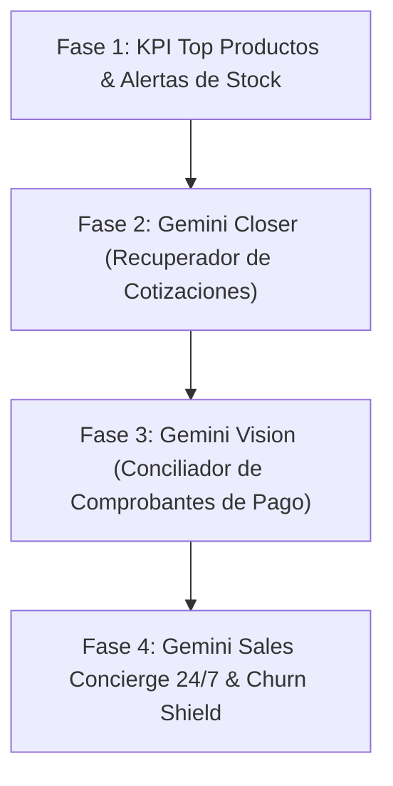

# 🇬 Ecosistema de Agentes Athleticenter impulsado 100% por Google Gemini

Todo el ecosistema de inteligencia artificial para Athleticenter se integrará exclusivamente sobre el stack oficial de **Google Cloud & Google Gemini (Genkit / Gemini 1.5 & 2.0 Flash / Pro)**, aprovechando que ya tienes `@genkit-ai/google-genai` en el proyecto.

---

## 🏗️ Los 5 Agentes Especializados de Google Gemini

### 1. 🤖 Gemini Closer (Agente Negociador y Rescate de Proformas)
* **Motor:** `gemini-1.5-flash` (ultra veloz y económico).
* **Función:** Analiza la cotización abierta, calcula el margen y redacta un mensaje persuasivo personalizado para WhatsApp.
* **Inteligencia:**
  - Venta cruzada según categorías de producto.
  - Asignación de incentivos dinámicos:
    - *Ticket Alto:* Envío nacional bonificado.
    - *Ticket Medio:* Descuento estratégico (3% - 5%).
    - *Ticket Bajo:* Merchandising oficial de regalo (toalla / accesorio).
  - Recolección y clasificación automática de objeciones cuando el cliente declina.

### 2. 👁️ Gemini Vision Auditor (Conciliación Automática de Comprobantes)
* **Motor:** Multimodal de **Gemini Vision** (análisis de imágenes y documentos).
* **Función:** Procesa capturas de pantalla de transferencias, depósitos, pagos móviles o Zelle que el cliente envíe.
* **Extracción Estructurada:**
  - Banco emisor y receptor.
  - Número de referencia exacto.
  - Monto y divisa (USD / VES / Tasa).
  - Fecha y hora.
* **Validación:** Cruza la referencia y monto contra la orden pendiente en Firestore y marca el abono en estado *"Pre-verificado por Gemini"* para confirmación de Tesorería a un solo clic.

### 3. 💬 Gemini Sales Concierge 24/7 (Vendedor y Catálogo Inteligente)
* **Motor:** `gemini-1.5-flash` con Function Calling / Herramientas hacia Firebase.
* **Función:** Atiende dudas de inventario y características por WhatsApp fuera de horario laboral.
* **Capacidades:**
  - Consulta en vivo disponibilidad y precio en catálogo.
  - Asesora según la necesidad del cliente (ej. peso recomendado, dimensiones de racks, barras olímpicas).
  - Genera automáticamente el borrador de cotización en el sistema.

### 4. 🎯 Gemini Churn Shield (Reactivación de Clientes Inactivos)
* **Motor:** `gemini-1.5-flash` para análisis de recurrencia.
* **Función:** Identifica clientes habituales que superan 45-60 días sin actividad.
* **Acción:** Diseña ofertas hiperpersonalizadas basadas en las categorías que más solían comprar (gimnasios, distribuidores, retail) para reengancharlos por WhatsApp.

### 5. 📊 Gemini Executive Insights & KPI Top Productos
* **Motor:** Métricas nativas de agregación en Firestore + Gemini para insights gerenciales.
* **Función:** 
  - Panel visual en Dashboard con Top 5 productos por volumen y por rentabilidad.
  - Alerta predictiva de quiebre de stock antes de que los productos estrella se agoten.
  - Resumen ejecutivo semanal en audio/texto generado por Gemini para Gerencia.

---

## 📋 Plan de Implementación Escalonado

1. **Paso 1:** Desarrollar el widget visual de **Top 5 Productos Vendidos y Rentables** en el Dashboard + cálculo de proyección de stock.
2. **Paso 2:** Configurar el servicio base de Gemini con la API Key oficial de Google para el **Gemini Closer**.
3. **Paso 3:** Implementar el webhook de recepción y pipeline de **Gemini Vision** para comprobantes bancarios.
4. **Paso 4:** Activación del Asistente 24/7 y reactivación de clientes.

---

> ⚠️ **Regla Inviolable:** No se modificará ningún archivo de código del sistema hasta recibir tu autorización formal para el paso seleccionado.
